# CHƯƠNG 3: TRIỂN KHAI HỆ THỐNG VÀ KẾT QUẢ THỰC NGHIỆM

Chương này trình bày chi tiết quá trình hiện thực hóa bản thiết kế từ Chương 2 thành hệ thống phần mềm hoàn chỉnh, bao gồm: thiết lập môi trường thực nghiệm khép kín trên mạng chuỗi khối cục bộ Anvil (Foundry), cài đặt 6 hợp đồng thông minh bằng ngôn ngữ Solidity (phiên bản `0.8.24` kết hợp thư viện OpenZeppelin v5), xây dựng dịch vụ Backend (FastAPI, SQLAlchemy, Alembic, `web3.py`, Pinata IPFS, `Signer Service`) cùng cơ sở dữ liệu PostgreSQL 8 bảng, và phát triển ứng dụng giao diện người dùng (Next.js, TypeScript, Tailwind CSS, `ethers.js v6`). Cuối chương là kết quả kiểm thử tự động bằng `forge test` (độ bao phủ dòng lệnh đạt `94.74%`), phân tích tĩnh an toàn mã nguồn bằng công cụ Slither và kết quả chạy thực nghiệm xuyên suốt 14 ca sử dụng (UC-01 đến UC-14).

---

## 3.1. Môi trường triển khai và Cấu trúc mã nguồn dự án

### 3.1.1. Công cụ, thư viện và thông số môi trường thực nghiệm

Để đảm bảo tính nhất quán, khả năng tái lập hoàn toàn (đáp ứng yêu cầu phi chức năng `NFR-02`) và hoạt động độc lập không phụ thuộc vào ví trình duyệt bên thứ ba, hệ thống được xây dựng và thực nghiệm trên bộ công nghệ tiêu chuẩn công nghiệp được liệt kê trong Bảng 3.1.

**Bảng 3.1 – Danh mục công nghệ, thư viện và thông số môi trường triển khai**

| Phân lớp | Công nghệ / Thư viện | Phiên bản | Vai trò trong hệ thống |
| :--- | :--- | :--- | :--- |
| **Lớp Blockchain & Smart Contract** | Foundry (`forge`, `anvil`, `cast`) | `v1.0.0+` | Biên dịch, kiểm thử tự động, đo độ bao phủ (`forge coverage`) và chạy node EVM cục bộ (`anvil`). |
| | Solidity Compiler (`solc`) | `0.8.24` | Ngôn ngữ lập trình hợp đồng thông minh (tích hợp sẵn kiểm tra tràn số tự động và hỗ trợ Custom Errors). |
| | OpenZeppelin Contracts | `v5.0.2` | Thư viện chuẩn cho `ERC20`, `AccessControl`, `Pausable`, `ReentrancyGuard`, `SafeERC20`. |
| | Slither Analyzer | `0.10.x` | Công cụ phân tích tĩnh phát hiện lỗ hổng bảo mật trên mã nguồn Solidity. |
| **Lớp Backend & Dịch vụ nền** | Python & FastAPI | `Python 3.11+` / `0.115.x` | Xây dựng REST API bất đồng bộ, quản lý phiên đăng nhập (`Session Lab`) và điều phối nghiệp vụ. |
| | SQLAlchemy & Alembic | `2.0.x` / `1.13.x` | Ánh xạ quan hệ đối tượng (ORM) và quản lý phiên bản lược đồ cơ sở dữ liệu 8 bảng. |
| | PostgreSQL | `16.x` | Hệ quản trị cơ sở dữ liệu quan hệ lưu trữ hồ sơ KYC, metadata BĐS, bộ nhớ đệm sự kiện và nhật ký `audit_signs`. |
| | `web3.py` & `eth-account` | `6.15.x` | Ký giao dịch phía máy chủ (`Server-side Signing`), gửi lệnh RPC tới Anvil `:8545` và lắng nghe sự kiện (`Event Indexer`). |
| | Pinata IPFS API (`httpx`) | `v3 REST API` | Lưu trữ phi tập trung tệp hồ sơ pháp lý giả lập (PDF/ảnh), trả về định danh `docCID`. |
| **Lớp Giao diện (Frontend DApp)** | Next.js (App Router) & React | `14.2.x` / `18.3.x` | Framework xây dựng giao diện web 7 màn hình theo kiến trúc Component-based. |
| | TypeScript & Tailwind CSS | `5.x` / `3.4.x` | Đảm bảo an toàn kiểu dữ liệu tĩnh và thiết kế giao diện trực quan theo từng vai trò. |
| | `ethers.js` | `v6.13.x` | Kết nối chỉ đọc (`JsonRpcProvider`) tới `http://127.0.0.1:8545` để truy vấn số dư `balanceOf` và đối chiếu trạng thái thời gian thực. |

### 3.1.2. Cấu trúc thư mục dự án

Mã nguồn của toàn hệ thống được tổ chức theo cấu trúc Monorepo gồm 4 phân khu chính (`contracts/`, `backend/`, `frontend/`, `scripts/`) giúp đồng bộ hóa ABI, địa chỉ hợp đồng và kịch bản khởi chạy tự động:

```text
rwa-real-estate-platform/
├── Makefile                        # Kịch bản tự động hóa (make demo-up, make test, make coverage)
├── .env.example                    # Mẫu cấu hình khóa ví Lab Anvil, kết nối PostgreSQL và Pinata JWT
├── contracts/                      # Phân hệ Hợp đồng thông minh (Foundry Project)
│   ├── foundry.toml                # Cấu hình trình biên dịch Solc 0.8.24 & OpenZeppelin remappings
│   ├── src/
│   │   ├── IdentityRegistry.sol    # Quản lý danh sách trắng KYC (addToWhitelist / removeFromWhitelist)
│   │   ├── AssetToken.sol          # Token BĐS chuẩn ERC-20 có kiểm soát tuân thủ tại _update
│   │   ├── AssetFactory.sol        # Nhà máy triển khai AssetToken cho từng bất động sản
│   │   ├── PrimarySale.sol         # Hợp đồng chào bán sơ cấp giá cố định bằng MockUSDC
│   │   ├── Marketplace.sol         # Chợ thứ cấp theo cơ chế ký quỹ giá cố định (Fixed-price Escrow)
│   │   └── MockUSDC.sol            # Đồng stablecoin giả lập 6 chữ số thập phân tích hợp faucet()
│   ├── script/
│   │   └── Deploy.s.sol            # Kịch bản triển khai tự động 6 contract & phân quyền RBAC ban đầu
│   └── test/                       # Bộ 36 kịch bản kiểm thử đơn vị và tích hợp (Foundry Tests)
├── backend/                        # Phân hệ Máy chủ API, Signer Service & Event Indexer (FastAPI)
│   ├── alembic/                    # Các tệp quản lý di trú lược đồ CSDL (Migrations)
│   └── app/
│       ├── main.py                 # Điểm khởi chạy ứng dụng FastAPI, cấu hình CORS & khởi tạo dữ liệu seed
│       ├── config.py               # Quản lý biến môi trường và ánh xạ khóa bí mật Lab theo vai trò
│       ├── database.py             # Kết nối PostgreSQL và quản lý phiên làm việc SQLAlchemy
│       ├── models.py               # Định nghĩa 8 bảng thực thể theo ERD Chương 2
│       ├── schemas.py              # Các lớp kiểm tra dữ liệu đầu vào/đầu ra (Pydantic v2)
│       ├── services/
│       │   ├── signer.py           # Mô-đun Server-side Signing & ghi nhận nhật ký audit_signs
│       │   ├── indexer.py          # Tiến trình nền web3.py đồng bộ sự kiện từ Anvil về PostgreSQL
│       │   └── ipfs_pinata.py      # Dịch vụ đẩy tệp lên Pinata IPFS và tính mã băm docHash (Keccak-256)
│       └── api/
│           ├── auth.py             # API đăng nhập phiên thực nghiệm (POST /auth/login)
│           ├── kyc.py              # API nộp, duyệt, từ chối và thu hồi KYC
│           ├── assets.py           # API đăng ký BĐS, token hóa on-chain và cập nhật định giá
│           ├── trading.py          # API mở bán/mua sơ cấp, niêm yết/mua/hủy thứ cấp & P2P transfer
│           └── query.py            # API tra cứu cơ cấu sở hữu, lịch sử giao dịch và nhật ký kiểm toán
├── frontend/                       # Phân hệ Giao diện người dùng (Next.js + TypeScript + ethers.js v6)
│   └── src/
│       ├── context/SessionContext.tsx  # Quản lý phiên đăng nhập Lab & JsonRpcProvider chỉ đọc
│       ├── contracts/                  # ABI và địa chỉ 6 hợp đồng thông minh xuất từ Foundry
│       └── app/                        # 7 trang giao diện: /login, /assets, /assets/[id], /wallet, /kyc, /marketplace, /admin
└── scripts/
    └── demo_up.ps1                 # Kịch bản khởi chạy đồng bộ Anvil + Deploy + Seed + Backend + Frontend
```

### 3.1.3. Cấu hình mạng cục bộ Anvil và Khởi tạo tài khoản dự án (Seed Accounts)

Khi khởi chạy mạng cục bộ bằng lệnh `anvil --host 127.0.0.1 --port 8545 --chain-id 31337 --mnemonic "test test test test test test test test test test test junk"`, node EVM tạo ra các tài khoản tất định (deterministic EOA) với số dư ban đầu `10,000 ETH` giả lập để trả phí gas. Hệ thống gán cố định 5 tài khoản đầu tiên cho 5 tác nhân thực nghiệm như trong Bảng 3.2.

**Bảng 3.2 – Quy hoạch tài khoản dự án (Seed Accounts) trong môi trường Lab Anvil**

| Chỉ số HD | Tên hiển thị trên UI (`display_name`) | Vai trò (`role_label`) | Địa chỉ ví EOA cố định trên Anvil (`address`) | Quyền On-chain được cấp khi Deploy |
| :---: | :--- | :--- | :--- | :--- |
| `#0` | **Quản trị viên Hệ thống (Admin)** | `admin` | `0xf39Fd6e51aad88F6F4ce6aB8827279cffFb92266` | `DEFAULT_ADMIN_ROLE` trên toàn bộ hệ thống |
| `#1` | **Đơn vị Phát hành BĐS (Issuer)** | `issuer` | `0x70997970C51812dc3A010C7d01b50e0d17dc79C8` | `ISSUER_ROLE` trên `AssetFactory`, `AssetToken`, `PrimarySale` |
| `#2` | **Cán bộ Tuân thủ KYC (Compliance)** | `compliance` | `0x3C44CdDdB6a900fa2b585dd299e03d12FA4293BC` | `COMPLIANCE_ROLE` trên `IdentityRegistry`, `AssetToken` |
| `#3` | **Nhà đầu tư A (Nguyễn Văn An)** | `investor` | `0x90F79bf6EB2c4f870365E785982E1f101E93b906` | EOA Nhà đầu tư (được duyệt KYC mẫu trong kịch bản) |
| `#4` | **Nhà đầu tư B (Trần Thị Bình)** | `investor` | `0x15d34AAf54267DB7D7c367839AAf71A00a2C6A65` | EOA Nhà đầu tư (dùng kiểm thử mua thứ cấp, P2P, đóng băng) |

---

## 3.2. Triển khai hệ thống Hợp đồng thông minh (Smart Contracts)

Toàn bộ 6 hợp đồng thông minh được cài đặt theo đúng biểu đồ lớp (Mục `2.4.3.b`) và ma trận phân quyền RBAC (Mục `2.4.3.e`).

### 3.2.1. Hợp đồng quản lý danh sách trắng KYC (`IdentityRegistry.sol`)

Hợp đồng `IdentityRegistry` kế thừa `AccessControl` của OpenZeppelin v5, đóng vai trò là nguồn chân lý duy nhất (Single Source of Truth) trên chuỗi về trạng thái xác minh danh tính của nhà đầu tư và các hợp đồng ký quỹ (`PrimarySale`, `Marketplace`).

```solidity
// SPDX-License-Identifier: MIT
pragma solidity 0.8.24;

import {AccessControl} from "@openzeppelin/contracts/access/AccessControl.sol";

contract IdentityRegistry is AccessControl {
    bytes32 public constant COMPLIANCE_ROLE = keccak256("COMPLIANCE_ROLE");

    mapping(address => bool) private _whitelisted;

    event Whitelisted(address indexed account, address indexed operator);
    event RemovedFromWhitelist(address indexed account, address indexed operator);

    error ZeroAddress();
    error AlreadyWhitelisted(address account);
    error NotWhitelisted(address account);

    constructor(address admin, address compliance) {
        if (admin == address(0) || compliance == address(0)) revert ZeroAddress();
        _grantRole(DEFAULT_ADMIN_ROLE, admin);
        _grantRole(COMPLIANCE_ROLE, compliance);
    }

    function addToWhitelist(address account) external onlyRole(COMPLIANCE_ROLE) {
        if (account == address(0)) revert ZeroAddress();
        if (_whitelisted[account]) revert AlreadyWhitelisted(account);
        _whitelisted[account] = true;
        emit Whitelisted(account, msg.sender);
    }

    function removeFromWhitelist(address account) external onlyRole(COMPLIANCE_ROLE) {
        if (account == address(0)) revert ZeroAddress();
        if (!_whitelisted[account]) revert NotWhitelisted(account);
        _whitelisted[account] = false;
        emit RemovedFromWhitelist(account, msg.sender);
    }

    function isVerified(address account) external view returns (bool) {
        return _whitelisted[account];
    }
}
```

### 3.2.2. Hợp đồng Token bất động sản có kiểm soát tuân thủ (`AssetToken.sol`)

Mỗi bất động sản sau khi đăng ký được đại diện bởi một hợp đồng `AssetToken` riêng biệt. Điểm cốt lõi trong cài đặt của `AssetToken` là ghi đè hàm nội bộ `_update(address from, address to, uint256 value)` của chuẩn ERC-20 (OpenZeppelin v5) để cưỡng chế kiểm tra tuân thủ trên mọi thao tác làm biến동 số dư, kết hợp cờ trạng thái `_inForcedTransfer` để hỗ trợ chuyển nhượng cưỡng chế khi giải quyết tranh chấp.

```solidity
// SPDX-License-Identifier: MIT
pragma solidity 0.8.24;

import {ERC20} from "@openzeppelin/contracts/token/ERC20/ERC20.sol";
import {AccessControl} from "@openzeppelin/contracts/access/AccessControl.sol";
import {Pausable} from "@openzeppelin/contracts/utils/Pausable.sol";
import {IdentityRegistry} from "./IdentityRegistry.sol";

contract AssetToken is ERC20, AccessControl, Pausable {
    bytes32 public constant ISSUER_ROLE = keccak256("ISSUER_ROLE");
    bytes32 public constant COMPLIANCE_ROLE = keccak256("COMPLIANCE_ROLE");
    string public constant CONSTANT_ASSET_TYPE = "RealEstate";

    IdentityRegistry public identityRegistry;
    uint256 public valuation;
    string public docCID;
    bytes32 public docHash;

    mapping(address => bool) private _frozen;
    bool private _inForcedTransfer;

    event Frozen(address indexed account, bool isFrozen, address indexed operator);
    event ForcedTransfer(address indexed from, address indexed to, uint256 amount, address indexed admin);
    event ValuationUpdated(uint256 oldValuation, uint256 newValuation, address indexed issuer);

    error ZeroAddress();
    error InvalidAmount();
    error AccountFrozen(address account);
    error AccountNotWhitelisted(address account);
    error InvalidForcedTransferRecipient(address recipient);

    constructor(
        string memory name_,
        string memory symbol_,
        uint256 totalShares_,
        uint256 valuation_,
        string memory docCID_,
        bytes32 docHash_,
        address identityRegistry_,
        address admin_,
        address issuer_,
        address compliance_,
        address initialReceiver_
    ) ERC20(name_, symbol_) {
        if (identityRegistry_ == address(0) || admin_ == address(0) || issuer_ == address(0) || initialReceiver_ == address(0)) {
            revert ZeroAddress();
        }
        if (totalShares_ == 0 || valuation_ == 0) revert InvalidAmount();

        identityRegistry = IdentityRegistry(identityRegistry_);
        valuation = valuation_;
        docCID = docCID_;
        docHash = docHash_;

        _grantRole(DEFAULT_ADMIN_ROLE, admin_);
        _grantRole(ISSUER_ROLE, issuer_);
        _grantRole(COMPLIANCE_ROLE, compliance_);

        _mint(initialReceiver_, totalShares_);
    }

    function setFrozen(address account, bool frozen) external onlyRole(COMPLIANCE_ROLE) {
        if (account == address(0)) revert ZeroAddress();
        _frozen[account] = frozen;
        emit Frozen(account, frozen, msg.sender);
    }

    function isFrozen(address account) external view returns (bool) {
        return _frozen[account];
    }

    function updateValuation(uint256 newValuation) external onlyRole(ISSUER_ROLE) {
        if (newValuation == 0) revert InvalidAmount();
        uint256 oldVal = valuation;
        valuation = newValuation;
        emit ValuationUpdated(oldVal, newValuation, msg.sender);
    }

    function pause() external onlyRole(DEFAULT_ADMIN_ROLE) {
        _pause();
    }

    function unpause() external onlyRole(DEFAULT_ADMIN_ROLE) {
        _unpause();
    }

    function forcedTransfer(
        address from,
        address to,
        uint256 amount
    ) external onlyRole(DEFAULT_ADMIN_ROLE) {
        if (from == address(0) || to == address(0) || _frozen[to] || !identityRegistry.isVerified(to)) {
            revert InvalidForcedTransferRecipient(to);
        }
        _inForcedTransfer = true;
        _update(from, to, amount);
        _inForcedTransfer = false;
        emit ForcedTransfer(from, to, amount, msg.sender);
    }

    function _update(
        address from,
        address to,
        uint256 value
    ) internal override whenNotPaused {
        if (!_inForcedTransfer) {
            if (from != address(0)) {
                if (_frozen[from]) revert AccountFrozen(from);
                if (!identityRegistry.isVerified(from)) revert AccountNotWhitelisted(from);
            }
            if (to != address(0)) {
                if (_frozen[to]) revert AccountFrozen(to);
                if (!identityRegistry.isVerified(to)) revert AccountNotWhitelisted(to);
            }
        }
        super._update(from, to, value);
    }
}
```

### 3.2.3. Hợp đồng nhà máy phát hành tài sản (`AssetFactory.sol`)

Hợp đồng `AssetFactory` cho phép tác nhân có quyền `ISSUER_ROLE` triển khai hợp đồng `AssetToken` mới chỉ bằng một giao dịch duy nhất, đồng thời tự động đúc (`mint`) toàn bộ `totalShares` vào kho lưu trữ sơ cấp (`initialReceiver` là địa chỉ hợp đồng `PrimarySale` hoặc ví Issuer được whitelist).

```solidity
// SPDX-License-Identifier: MIT
pragma solidity 0.8.24;

import {AccessControl} from "@openzeppelin/contracts/access/AccessControl.sol";
import {AssetToken} from "./AssetToken.sol";
import {IdentityRegistry} from "./IdentityRegistry.sol";

contract AssetFactory is AccessControl {
    bytes32 public constant ISSUER_ROLE = keccak256("ISSUER_ROLE");

    IdentityRegistry public identityRegistry;
    address public defaultAdmin;
    address public defaultCompliance;
    address[] public deployedTokens;

    event AssetCreated(
        address indexed token,
        string name,
        string symbol,
        uint256 totalShares,
        uint256 valuation,
        string docCID,
        bytes32 docHash,
        address indexed issuer
    );

    error ZeroAddress();

    constructor(address admin_, address issuer_, address compliance_, address identityRegistry_) {
        if (admin_ == address(0) || issuer_ == address(0) || compliance_ == address(0) || identityRegistry_ == address(0)) {
            revert ZeroAddress();
        }
        _grantRole(DEFAULT_ADMIN_ROLE, admin_);
        _grantRole(ISSUER_ROLE, issuer_);
        defaultAdmin = admin_;
        defaultCompliance = compliance_;
        identityRegistry = IdentityRegistry(identityRegistry_);
    }

    function createAsset(
        string calldata name,
        string calldata symbol,
        uint256 totalShares,
        uint256 valuation,
        string calldata docCID,
        bytes32 docHash,
        address initialReceiver
    ) external onlyRole(ISSUER_ROLE) returns (address) {
        AssetToken newToken = new AssetToken(
            name,
            symbol,
            totalShares,
            valuation,
            docCID,
            docHash,
            address(identityRegistry),
            defaultAdmin,
            msg.sender,
            defaultCompliance,
            initialReceiver
        );

        address tokenAddr = address(newToken);
        deployedTokens.push(tokenAddr);

        emit AssetCreated(tokenAddr, name, symbol, totalShares, valuation, docCID, docHash, msg.sender);
        return tokenAddr;
    }

    function getDeployedTokens() external view returns (address[] memory) {
        return deployedTokens;
    }
}
```

### 3.2.4. Hợp đồng chào bán sơ cấp (`PrimarySale.sol`) và Đồng thanh toán (`MockUSDC.sol`)

Hợp đồng `PrimarySale` quản lý đợt mở bán sơ cấp theo từng địa chỉ `AssetToken`. Khi nhà đầu tư gọi `buy(token, amount)`, hợp đồng kiểm tra trạng thái xác minh KYC trên `IdentityRegistry`, tính tổng số tiền `MockUSDC` cần thanh toán theo đơn giá cố định `pricePerShare`, chuyển `MockUSDC` về ví thụ hưởng (`treasury` của Issuer) và chuyển `AssetToken` từ kho `PrimarySale` sang ví nhà đầu tư.

```solidity
// SPDX-License-Identifier: MIT
pragma solidity 0.8.24;

import {IERC20} from "@openzeppelin/contracts/token/ERC20/IERC20.sol";
import {SafeERC20} from "@openzeppelin/contracts/token/ERC20/utils/SafeERC20.sol";
import {AccessControl} from "@openzeppelin/contracts/access/AccessControl.sol";
import {ReentrancyGuard} from "@openzeppelin/contracts/utils/ReentrancyGuard.sol";
import {IdentityRegistry} from "./IdentityRegistry.sol";
import {AssetToken} from "./AssetToken.sol";

contract PrimarySale is AccessControl, ReentrancyGuard {
    using SafeERC20 for IERC20;

    bytes32 public constant ISSUER_ROLE = keccak256("ISSUER_ROLE");

    struct SaleInfo {
        address token;
        uint256 pricePerShare; // Đơn giá tính theo đơn vị nhỏ nhất của MockUSDC (6 decimals)
        uint256 totalAmount;
        uint256 remainingAmount;
        address treasury;
        bool isOpen;
    }

    IERC20 public mockUSDC;
    IdentityRegistry public identityRegistry;
    mapping(address => SaleInfo) public sales;

    event SaleOpened(address indexed token, uint256 pricePerShare, uint256 amount, address indexed issuer);
    event SaleClosed(address indexed token, uint256 remainingAmount);
    event PrimaryPurchased(address indexed token, address indexed buyer, uint256 amount, uint256 usdcPaid);

    error ZeroAddress();
    error InvalidParameters();
    error SaleNotOpen(address token);
    error BuyerNotWhitelisted(address buyer);
    error InsufficientRemainingShares(uint256 requested, uint256 available);

    constructor(address admin_, address issuer_, address mockUSDC_, address identityRegistry_) {
        if (admin_ == address(0) || issuer_ == address(0) || mockUSDC_ == address(0) || identityRegistry_ == address(0)) {
            revert ZeroAddress();
        }
        _grantRole(DEFAULT_ADMIN_ROLE, admin_);
        _grantRole(ISSUER_ROLE, issuer_);
        mockUSDC = IERC20(mockUSDC_);
        identityRegistry = IdentityRegistry(identityRegistry_);
    }

    function openSale(address token, uint256 pricePerShare, uint256 amount) external onlyRole(ISSUER_ROLE) {
        if (token == address(0) || pricePerShare == 0 || amount == 0) revert InvalidParameters();

        uint256 contractBalance = IERC20(token).balanceOf(address(this));
        if (contractBalance < amount) {
            IERC20(token).safeTransferFrom(msg.sender, address(this), amount - contractBalance);
        }

        sales[token] = SaleInfo({
            token: token,
            pricePerShare: pricePerShare,
            totalAmount: amount,
            remainingAmount: amount,
            treasury: msg.sender,
            isOpen: true
        });

        emit SaleOpened(token, pricePerShare, amount, msg.sender);
    }

    function closeSale(address token) external onlyRole(ISSUER_ROLE) {
        SaleInfo storage sale = sales[token];
        if (!sale.isOpen) revert SaleNotOpen(token);
        sale.isOpen = false;
        emit SaleClosed(token, sale.remainingAmount);
    }

    function buy(address token, uint256 amount) external nonReentrant {
        SaleInfo storage sale = sales[token];
        if (!sale.isOpen) revert SaleNotOpen(token);
        if (amount == 0) revert InvalidParameters();
        if (amount > sale.remainingAmount) {
            revert InsufficientRemainingShares(amount, sale.remainingAmount);
        }
        if (!identityRegistry.isVerified(msg.sender)) {
            revert BuyerNotWhitelisted(msg.sender);
        }

        uint8 tokenDecimals = AssetToken(token).decimals();
        uint256 totalCost = (amount * sale.pricePerShare) / (10 ** tokenDecimals);

        sale.remainingAmount -= amount;
        if (sale.remainingAmount == 0) {
            sale.isOpen = false;
        }

        mockUSDC.safeTransferFrom(msg.sender, sale.treasury, totalCost);
        IERC20(token).safeTransfer(msg.sender, amount);

        emit PrimaryPurchased(token, msg.sender, amount, totalCost);
    }
}
```

### 3.2.5. Hợp đồng chợ giao dịch thứ cấp ký quỹ giá cố định (`Marketplace.sol`)

Hợp đồng `Marketplace` hiện thực hóa mô hình **Fixed-price Escrow** (ký quỹ giá cố định, không dùng sổ lệnh order book), cho phép nhà đầu tư ký quỹ `AssetToken` vào hợp đồng qua hàm `list(token, amount, pricePerShare)`, hỗ trợ người mua khớp lệnh một phần hoặc toàn bộ qua hàm `buy(listingId, amount)` và cho phép người bán rút lại số phần chưa khớp qua hàm `cancel(listingId)`.

```solidity
// SPDX-License-Identifier: MIT
pragma solidity 0.8.24;

import {IERC20} from "@openzeppelin/contracts/token/ERC20/IERC20.sol";
import {SafeERC20} from "@openzeppelin/contracts/token/ERC20/utils/SafeERC20.sol";
import {ReentrancyGuard} from "@openzeppelin/contracts/utils/ReentrancyGuard.sol";
import {IdentityRegistry} from "./IdentityRegistry.sol";
import {AssetToken} from "./AssetToken.sol";

contract Marketplace is ReentrancyGuard {
    using SafeERC20 for IERC20;

    struct Listing {
        uint256 listingId;
        address token;
        address seller;
        uint256 initialAmount;
        uint256 remainingAmount;
        uint256 pricePerShare;
        bool isOpen;
    }

    IERC20 public mockUSDC;
    IdentityRegistry public identityRegistry;
    uint256 public nextListingId;
    mapping(uint256 => Listing) public listings;

    event Listed(uint256 indexed listingId, address indexed token, address indexed seller, uint256 amount, uint256 pricePerShare);
    event Bought(uint256 indexed listingId, address indexed token, address indexed buyer, uint256 amount, uint256 usdcPaid, uint256 remainingAmount);
    event Cancelled(uint256 indexed listingId, address indexed seller, uint256 refundedAmount);

    error ZeroAddress();
    error InvalidAmount();
    error ListingNotOpen(uint256 listingId);
    error NotSeller(address caller);
    error AccountNotWhitelisted(address account);
    error ExceedsRemaining(uint256 requested, uint256 available);

    constructor(address mockUSDC_, address identityRegistry_) {
        if (mockUSDC_ == address(0) || identityRegistry_ == address(0)) revert ZeroAddress();
        mockUSDC = IERC20(mockUSDC_);
        identityRegistry = IdentityRegistry(identityRegistry_);
    }

    function list(address token, uint256 amount, uint256 pricePerShare) external nonReentrant returns (uint256) {
        if (token == address(0)) revert ZeroAddress();
        if (amount == 0 || pricePerShare == 0) revert InvalidAmount();
        if (!identityRegistry.isVerified(msg.sender)) revert AccountNotWhitelisted(msg.sender);

        IERC20(token).safeTransferFrom(msg.sender, address(this), amount);

        uint256 listingId = nextListingId++;
        listings[listingId] = Listing({
            listingId: listingId,
            token: token,
            seller: msg.sender,
            initialAmount: amount,
            remainingAmount: amount,
            pricePerShare: pricePerShare,
            isOpen: true
        });

        emit Listed(listingId, token, msg.sender, amount, pricePerShare);
        return listingId;
    }

    function buy(uint256 listingId, uint256 amount) external nonReentrant {
        Listing storage item = listings[listingId];
        if (!item.isOpen) revert ListingNotOpen(listingId);
        if (amount == 0) revert InvalidAmount();
        if (amount > item.remainingAmount) revert ExceedsRemaining(amount, item.remainingAmount);
        if (!identityRegistry.isVerified(msg.sender)) revert AccountNotWhitelisted(msg.sender);

        uint8 tokenDecimals = AssetToken(item.token).decimals();
        uint256 totalCost = (amount * item.pricePerShare) / (10 ** tokenDecimals);

        item.remainingAmount -= amount;
        if (item.remainingAmount == 0) {
            item.isOpen = false;
        }

        mockUSDC.safeTransferFrom(msg.sender, item.seller, totalCost);
        IERC20(item.token).safeTransfer(msg.sender, amount);

        emit Bought(listingId, item.token, msg.sender, amount, totalCost, item.remainingAmount);
    }

    function cancel(uint256 listingId) external nonReentrant {
        Listing storage item = listings[listingId];
        if (!item.isOpen) revert ListingNotOpen(listingId);
        if (msg.sender != item.seller) revert NotSeller(msg.sender);

        item.isOpen = false;
        uint256 refund = item.remainingAmount;
        item.remainingAmount = 0;

        IERC20(item.token).safeTransfer(item.seller, refund);
        emit Cancelled(listingId, msg.sender, refund);
    }
}
```

### 3.2.6. Kịch bản triển khai tự động (`Deploy.s.sol`)

Khi thực thi `forge script script/Deploy.s.sol:DeployScript --rpc-url http://127.0.0.1:8545 --broadcast`, kịch bản tự động triển khai toàn bộ 6 hợp đồng, phân quyền cho các tài khoản Seed (`Admin`, `Issuer`, `Compliance`), đồng thời thêm địa chỉ hợp đồng `PrimarySale`, `Marketplace` và `Issuer` vào `IdentityRegistry` để cho phép các hợp đồng này nhận và chuyển token ký quỹ hợp lệ qua hàm `_update`.

**Bảng 3.3 – Địa chỉ tất định của các Hợp đồng thông minh trên mạng cục bộ Anvil (`Chain ID: 31337`)**

| STT | Tên Hợp đồng (`Contract`) | Địa chỉ triển khai trên Anvil (`Address`) | Vai trò khởi tạo & Cấu hình Whitelist |
| :---: | :--- | :--- | :--- |
| 1 | `IdentityRegistry` | `0x5FbDB2315678afecb367f032d93F642f64180aa3` | `Admin (#0)`, `Compliance (#2)` |
| 2 | `MockUSDC` | `0xe7f1725E7734CE288F8367e1Bb143E90bb3F0512` | Đúc sẵn nguồn cung thử nghiệm & mở hàm `faucet()` |
| 3 | `AssetFactory` | `0x9fE46736679d2D9a65F0992F2272dE9f3c7fa6e0` | Cấp `ISSUER_ROLE` cho `Issuer (#1)` |
| 4 | `PrimarySale` | `0xCf7Ed3AccA5a467e9e704C703E8D87F634fB0Fc9` | Được thêm vào `IdentityRegistry` whitelist để giữ kho sơ cấp |
| 5 | `Marketplace` | `0xDc64a140Aa3E981100a9becA4E685f962f0cF6C9` | Được thêm vào `IdentityRegistry` whitelist để giữ token Escrow |
| 6 | `AssetToken (VINH01)` | `0x0165878A594ca255338adfa4d48449f69242Eb8F` | BĐS mẫu được tạo bởi `AssetFactory.createAsset(...)` |

---

## 3.3. Triển khai dịch vụ Backend API, Signer Service và Event Indexer

### 3.3.1. Triển khai lược đồ Cơ sở dữ liệu PostgreSQL (SQLAlchemy & Alembic)

Mô hình dữ liệu trong tệp `backend/app/models.py` cài đặt chính xác 8 bảng thực thể đã thiết kế tại biểu đồ ERD (Mục `2.4.2.a`), sử dụng kiểu dữ liệu `Numeric(36, 18)` cho số lượng phần sở hữu chuẩn ERC-20 và `Numeric(36, 6)` cho giá trị định giá / đơn giá tính theo `MockUSDC`:

```python
from sqlalchemy import Column, Integer, BigInteger, String, Text, Boolean, Numeric, DateTime, ForeignKey
from sqlalchemy.dialects.postgresql import JSONB
from sqlalchemy.sql import func
from .database import Base

class User(Base):
    __tablename__ = "users"
    id = Column(Integer, primary_key=True, index=True)
    address = Column(String(42), unique=True, nullable=False, index=True)
    role_label = Column(String(30), nullable=False)        # admin | issuer | compliance | investor
    display_name = Column(String(100), nullable=False)
    is_whitelisted = Column(Boolean, default=False)
    is_frozen = Column(Boolean, default=False)
    created_at = Column(DateTime, server_default=func.now())

class SessionModel(Base):
    __tablename__ = "sessions"
    id = Column(Integer, primary_key=True)
    token = Column(String(128), unique=True, nullable=False, index=True)
    user_id = Column(Integer, ForeignKey("users.id"), nullable=False)
    expires_at = Column(DateTime, nullable=False)
    created_at = Column(DateTime, server_default=func.now())

class KYCApplication(Base):
    __tablename__ = "kyc_applications"
    id = Column(Integer, primary_key=True)
    user_id = Column(Integer, ForeignKey("users.id"), nullable=False)
    status = Column(String(20), default="pending", nullable=False) # pending | approved | rejected | revoked
    payload_json = Column(JSONB, nullable=False)                   # Họ tên giả, số CCCD giả, đường dẫn tệp
    reviewed_by = Column(Integer, ForeignKey("users.id"), nullable=True)
    tx_hash = Column(String(66), nullable=True)
    reviewed_at = Column(DateTime, nullable=True)
    created_at = Column(DateTime, server_default=func.now())

class RealEstate(Base):
    __tablename__ = "real_estates"
    id = Column(Integer, primary_key=True)
    token_address = Column(String(42), unique=True, nullable=True, index=True)
    name = Column(String(120), nullable=False)
    symbol = Column(String(20), nullable=False)
    address_text = Column(Text, nullable=False)
    area_m2 = Column(Numeric(12, 2), nullable=False)
    property_kind = Column(String(40), nullable=False)             # apartment | land | building
    build_year = Column(Integer, nullable=True)
    description = Column(Text, nullable=True)
    valuation = Column(Numeric(36, 6), nullable=False)
    total_shares = Column(Numeric(36, 18), nullable=False)
    doc_cid = Column(String(100), nullable=False)
    doc_hash = Column(String(66), nullable=False)
    status = Column(String(30), default="draft", nullable=False)   # draft | ready_to_tokenize | tokenized | open_sale
    created_by = Column(Integer, ForeignKey("users.id"), nullable=False)
    created_at = Column(DateTime, server_default=func.now())

class AuditSign(Base):
    __tablename__ = "audit_signs"
    id = Column(Integer, primary_key=True)
    user_id = Column(Integer, ForeignKey("users.id"), nullable=False)
    signer_address = Column(String(42), nullable=False)
    role_label = Column(String(30), nullable=False)
    contract_method = Column(String(60), nullable=False)
    params_json = Column(JSONB, nullable=False)
    tx_hash = Column(String(66), nullable=False)
    signed_at = Column(DateTime, server_default=func.now())

class PrimarySaleCache(Base):
    __tablename__ = "primary_sales_cache"
    id = Column(Integer, primary_key=True)
    real_estate_id = Column(Integer, ForeignKey("real_estates.id"), nullable=False)
    token_address = Column(String(42), nullable=False, index=True)
    price_per_share = Column(Numeric(36, 6), nullable=False)
    total_amount = Column(Numeric(36, 18), nullable=False)
    remaining_amount = Column(Numeric(36, 18), nullable=False)
    is_open = Column(Boolean, default=True)
    updated_at = Column(DateTime, server_default=func.now(), onupdate=func.now())

class ListingCache(Base):
    __tablename__ = "listings_cache"
    listing_id = Column(BigInteger, primary_key=True)
    real_estate_id = Column(Integer, ForeignKey("real_estates.id"), nullable=False)
    token_address = Column(String(42), nullable=False, index=True)
    seller_address = Column(String(42), nullable=False)
    initial_amount = Column(Numeric(36, 18), nullable=False)
    remaining_amount = Column(Numeric(36, 18), nullable=False)
    price_per_share = Column(Numeric(36, 6), nullable=False)
    status = Column(String(20), default="open")                    # open | filled | cancelled
    tx_hash = Column(String(66), nullable=False)
    updated_at = Column(DateTime, server_default=func.now(), onupdate=func.now())

class TransferCache(Base):
    __tablename__ = "transfers_cache"
    id = Column(Integer, primary_key=True)
    tx_hash = Column(String(66), nullable=False, index=True)
    block_number = Column(BigInteger, nullable=False)
    event_type = Column(String(30), nullable=False)                # MINT | PRIMARY_BUY | P2P | MARKET_BUY | FORCED_TRANSFER
    token_address = Column(String(42), nullable=False, index=True)
    from_address = Column(String(42), nullable=False)
    to_address = Column(String(42), nullable=False)
    amount = Column(Numeric(36, 18), nullable=False)
    usdc_paid = Column(Numeric(36, 6), nullable=True)
    created_at = Column(DateTime, server_default=func.now())
```

### 3.3.2. Triển khai dịch vụ Ký giao dịch phía máy chủ (`Signer Service`) và Kiểm toán (`audit_signs`)

Mô-đun `Signer Service` (`backend/app/services/signer.py`) là thành phần kỹ thuật trọng tâm giúp hệ thống vận hành theo mô hình **Session Lab** mà không cần MetaMask. Khi một API ghi được gọi, `Signer Service` thực hiện 4 bước kiểm soát nghiêm ngặt (đáp ứng `NFR-01`):
1. Xác thực phiên đăng nhập (`sessions.token`) và đối chiếu vai trò của người dùng (`user.role_label`) với quyền được phép gọi hàm hợp đồng.
2. Tra cứu khóa bí mật (`private_key`) trong bộ nhớ của tài khoản Lab tương ứng với `user.address`.
3. Khởi tạo giao dịch EVM với `chainId = 31337`, tự động lấy `nonce` mới nhất từ node Anvil `:8545`, ký số bằng `w3.eth.account.sign_transaction(...)`, phát giao dịch và chờ biên nhận (`wait_for_transaction_receipt`).
4. Lưu vết bắt buộc vào bảng `audit_signs` (bao gồm `user_id`, `signer_address`, `role_label`, `contract_method`, `params_json`, `tx_hash`).

```python
from web3 import Web3
from sqlalchemy.orm import Session
from ..models import User, AuditSign
from ..config import settings

w3 = Web3(Web3.HTTPProvider(settings.ANVIL_RPC_URL))

class SignerService:
    @staticmethod
    def sign_and_send(
        db: Session,
        current_user: User,
        contract_function,
        contract_method_name: str,
        params_summary: dict,
        required_role: str | None = None
    ) -> dict:
        if required_role and current_user.role_label != required_role:
            raise PermissionError(f"Yêu cầu vai trò {required_role}, phiên hiện tại là {current_user.role_label}")

        private_key = settings.LAB_PRIVATE_KEYS.get(current_user.address.lower())
        if not private_key:
            raise ValueError(f"Không tìm thấy khóa ví Lab cho địa chỉ {current_user.address}")

        checksum_addr = Web3.to_checksum_address(current_user.address)
        nonce = w3.eth.get_transaction_count(checksum_addr, "pending")

        tx = contract_function.build_transaction({
            "from": checksum_addr,
            "chainId": settings.CHAIN_ID,
            "gas": 3_000_000,
            "gasPrice": w3.eth.gas_price,
            "nonce": nonce,
        })

        signed_tx = w3.eth.account.sign_transaction(tx, private_key=private_key)
        tx_hash_bytes = w3.eth.send_raw_transaction(signed_tx.raw_transaction)
        receipt = w3.eth.wait_for_transaction_receipt(tx_hash_bytes, timeout=30)

        if receipt.status != 1:
            raise RuntimeError(f"Giao dịch bị từ chối (revert) trên chuỗi: {tx_hash_bytes.hex()}")

        tx_hash_hex = receipt.transactionHash.hex()
        audit_entry = AuditSign(
            user_id=current_user.id,
            signer_address=current_user.address,
            role_label=current_user.role_label,
            contract_method=contract_method_name,
            params_json=params_summary,
            tx_hash=tx_hash_hex
        )
        db.add(audit_entry)
        db.commit()

        return {"tx_hash": tx_hash_hex, "receipt": receipt}
```

Nhờ kiến trúc này, đối với các nghiệp vụ cần 2 giao dịch liên tiếp như **Mua sơ cấp (`UC-09`)** hoặc **Niêm yết thứ cấp (`UC-11`)**, Backend tự động gộp `MockUSDC.approve(...)` + `PrimarySale.buy(...)` (hoặc `AssetToken.approve(...)` + `Marketplace.list(...)`) trong cùng một lời gọi REST API, vừa ghi nhận đầy đủ 2 dòng kiểm toán vào `audit_signs`, vừa mang lại trải nghiệm một chạm mượt mà trên giao diện.

### 3.3.3. Tích hợp lưu trữ hồ sơ pháp lý trên IPFS (Pinata) và Băm tài liệu (`docHash`)

Trong mô-đun `backend/app/services/ipfs_pinata.py`, khi Đơn vị phát hành (`Issuer`) tải lên tệp PDF/ảnh hồ sơ pháp lý giả lập của bất động sản (`UC-04`):
1. Hệ thống đọc toàn bộ luồng byte của tệp và tính mã băm mật mã `docHash = "0x" + Web3.keccak(file_bytes).hex()` (định dạng `bytes32` dài 66 ký tự có tiền tố `0x`).
2. Gửi tệp qua giao thức `multipart/form-data` lên điểm cuối `https://api.pinata.cloud/pinning/pinFileToIPFS` bằng khóa xác thực `PINATA_JWT` (kèm cơ chế lưu bản sao cục bộ tại `backend/storage/ipfs_cache` để phục vụ tra cứu nhanh khi thực nghiệm ngoại tuyến) và nhận về mã định danh `docCID`.
3. Cặp giá trị `(docCID, docHash)` được lưu vào bảng `real_estates` và ghi bất biến lên hợp đồng `AssetToken` khi gọi `AssetFactory.createAsset(...)`. Người dùng ở bất kỳ vai trò nào đều có thể tải tệp từ IPFS về và kiểm chứng mã băm khớp tuyệt đối với `AssetToken.docHash()` trên chuỗi.

### 3.3.4. Triển khai bộ lắng nghe và đồng bộ sự kiện chuỗi khối (`Event Indexer — web3.py`)

Tiến trình nền `Event Indexer` (`backend/app/services/indexer.py`) kết nối tới `http://127.0.0.1:8545`, quét các khối mới phát sinh trên mạng Anvil theo chu kỳ `1.0 giây` và giải mã 10 sự kiện từ 6 hợp đồng thông minh để cập nhật tức thì vào PostgreSQL (đáp ứng `NFR-05`):
- Sự kiện `Whitelisted` / `RemovedFromWhitelist` (`IdentityRegistry`) $\rightarrow$ cập nhật cột `users.is_whitelisted`.
- Sự kiện `Frozen` (`AssetToken`) $\rightarrow$ cập nhật cột `users.is_frozen`.
- Sự kiện `AssetCreated` (`AssetFactory`) $\rightarrow$ cập nhật `real_estates.token_address`, chuyển `status = 'tokenized'` và ghi nhận bản ghi `MINT` vào `transfers_cache`.
- Sự kiện `SaleOpened` / `SaleClosed` / `PrimaryPurchased` (`PrimarySale`) $\rightarrow$ đồng bộ bảng `primary_sales_cache`, cập nhật `real_estates.status = 'open_sale'` và ghi bản ghi `PRIMARY_BUY` kèm số tiền `usdc_paid` vào `transfers_cache`.
- Sự kiện `Listed` / `Bought` / `Cancelled` (`Marketplace`) $\rightarrow$ đồng bộ số lượng còn lại và trạng thái lệnh (`open`, `filled`, `cancelled`) trong bảng `listings_cache`, đồng thời ghi nhận `MARKET_BUY` vào `transfers_cache`.
- Sự kiện `Transfer` và `ForcedTransfer` (`AssetToken`) $\rightarrow$ phân loại chính xác giao dịch chuyển nhượng ngang hàng (`P2P`) hoặc cưỡng chế (`FORCED_TRANSFER`) vào bảng `transfers_cache`.

### 3.3.5. Tổng hợp các điểm cuối REST API (FastAPI)

Hệ thống REST API tại tầng Backend được phân nhóm rõ ràng theo 14 Use Cases như trình bày trong Bảng 3.4.

**Bảng 3.4 – Danh mục các điểm cuối REST API đã triển khai tại Backend FastAPI**

| Nhóm API | Phương thức & Đường dẫn (`Endpoint`) | Mã UC | Quyền gọi | Hậu quả On-chain & Off-chain |
| :--- | :--- | :---: | :--- | :--- |
| **1. Xác thực Lab** | `GET /auth/accounts` | UC-01 | Công khai | Trả về danh sách 5 tài khoản Lab đã seed kèm trạng thái KYC/Frozen. |
| | `POST /auth/login` | UC-01 | Tất cả | Tạo phiên trong bảng `sessions`, cấp Session Token / Cookie theo `user_id`. |
| **2. Quản lý KYC** | `POST /kyc` | UC-02 | `investor` | Lưu hồ sơ KYC giả lập (`payload_json` + tệp) vào `kyc_applications` (`pending`). |
| | `GET /kyc` | UC-03 | `compliance` | Truy vấn danh sách hồ sơ KYC lọc theo trạng thái (`pending` / `approved` / `rejected`). |
| | `POST /kyc/{id}/approve` | UC-03 | `compliance` | Ký `IdentityRegistry.addToWhitelist(addr)`, cập nhật DB `approved` & ghi `audit_signs`. |
| | `POST /kyc/{id}/reject` | UC-03 | `compliance` | Cập nhật trạng thái hồ sơ trong PostgreSQL thành `rejected` (không gọi chuỗi). |
| | `POST /kyc/{id}/revoke` | UC-03 | `compliance` | Ký `IdentityRegistry.removeFromWhitelist(addr)`, chuyển trạng thái thành `revoked`. |
| **3. Bất động sản & Token hóa** | `POST /assets` | UC-04 | `issuer` | Đẩy hồ sơ PDF lên Pinata nhận `docCID`, tính `docHash`, lưu `real_estates` (`ready_to_tokenize`). |
| | `POST /assets/{id}/tokenize` | UC-05 | `issuer` | Ký `AssetFactory.createAsset(...)`, triển khai `AssetToken` và mint vào kho `PrimarySale`. |
| | `POST /assets/{id}/valuation` | UC-07 | `issuer` | Ký `AssetToken.updateValuation(newVal)`, cập nhật định giá giả lập vào DB. |
| | `GET /assets` & `GET /assets/{id}` | UC-14 | Tất cả | Đọc danh sách và thông tin chi tiết BĐS, tiến độ bán sơ cấp và mã kiểm chứng `docHash`. |
| **4. Giao dịch Sơ cấp & Thứ cấp** | `POST /wallet/faucet` | UC-08 | `investor` | Ký `MockUSDC.faucet(investor, 50000e6)` cấp tiền thử nghiệm vào ví phiên hiện tại. |
| | `POST /sales/primary/open` | UC-06 | `issuer` | Ký `PrimarySale.openSale(token, pricePerShare, amount)`, mở đợt chào bán sơ cấp. |
| | `POST /sales/primary/buy` | UC-09 | `investor` | Gộp ký `MockUSDC.approve` + `PrimarySale.buy(token, amount)` trong một yêu cầu. |
| | `POST /tokens/transfer` | UC-10 | `investor` | Ký `AssetToken.transfer(to, amount)` chuyển nhượng trực tiếp P2P (kiểm tra tại `_update`). |
| | `POST /marketplace/list` | UC-11 | `investor` | Gộp ký `AssetToken.approve` + `Marketplace.list(token, N, P)` đưa token vào Escrow. |
| | `POST /marketplace/buy` | UC-11 | `investor` | Gộp ký `MockUSDC.approve` + `Marketplace.buy(listingId, M)` (hỗ trợ mua một phần). |
| | `POST /marketplace/cancel` | UC-11 | `investor` | Ký `Marketplace.cancel(listingId)` rút phần token chưa khớp về ví người bán. |
| **5. Tuân thủ & Quản trị khẩn cấp** | `POST /admin/freeze` | UC-12 | `compliance` | Ký `AssetToken.setFrozen(account, bool)` đóng băng hoặc mở băng tài khoản mục tiêu. |
| | `POST /admin/pause` | UC-13 | `admin` | Ký `AssetToken.pause()` hoặc `unpause()` tạm dừng/khôi phục giao dịch hợp đồng token. |
| | `POST /admin/forced-transfer` | UC-13 | `admin` | Ký `AssetToken.forcedTransfer(from, to, amount)` thu hồi token sang ví mới đã KYC. |
| | `POST /admin/roles` | UC-13 | `admin` | Ký `grantRole` / `revokeRole` cấp hoặc thu hồi quyền trên hợp đồng thông minh. |
| **6. Tra cứu & Kiểm toán** | `GET /ownership/{address}` | UC-14 | Tất cả | Trả về danh mục BĐS đang nắm giữ, số dư và tỉ lệ sở hữu `balanceOf / totalShares`. |
| | `GET /transactions` | UC-14 | Tất cả | Trả về lịch sử biến động đã đồng bộ từ bảng `transfers_cache`. |
| | `GET /audit-signs` | UC-13 | `admin` | Truy xuất toàn bộ nhật ký ký giao dịch phía máy chủ từ bảng `audit_signs`. |

---

## 3.4. Triển khai ứng dụng Giao diện người dùng (Frontend Next.js)

### 3.4.1. Quản lý phiên đăng nhập thực nghiệm (`Session Lab`) và Kết nối Read-only RPC (`ethers.js v6`)

Trên tầng Frontend (`frontend/src/context/SessionContext.tsx`), ứng dụng loại bỏ hoàn toàn sự phụ thuộc vào `window.ethereum` (MetaMask) và thay thế bằng bộ điều phối kép:
1. **Quản lý phiên làm việc (`Session State`)**: Lưu trữ thông tin tài khoản Lab đang đăng nhập (`user_id`, `address`, `role_label`, `display_name`, `session_token`) và tự động đính kèm header `Authorization: Bearer <session_token>` vào mọi yêu cầu gọi tới FastAPI. Thanh điều hướng phía trên (`Header.tsx`) cho phép người thực nghiệm nhận biết rõ đang thao tác dưới vai trò nào (`Admin`, `Issuer`, `Compliance`, `Investor A`, `Investor B`) và hỗ trợ chuyển đổi nhanh phiên làm việc để kiểm thử kịch bản đa tác nhân.
2. **Truy vấn chuỗi khối trực tiếp ở chế độ chỉ đọc (`Read-only RPC`)**: Khởi tạo đối tượng `const rpcProvider = new ethers.JsonRpcProvider("http://127.0.0.1:8545")` để đọc trực tiếp `AssetToken.balanceOf(account)`, `AssetToken.totalSupply()`, `MockUSDC.balanceOf(account)` và `IdentityRegistry.isVerified(account)`, đảm bảo số liệu hiển thị trên giao diện khớp tuyệt đối với trạng thái thực tế trên mạng Anvil (`NFR-05`).

```typescript
// Trích đoạn kết nối Read-only RPC bằng ethers.js v6 trong SessionContext.tsx
const rpcProvider = new ethers.JsonRpcProvider(
  process.env.NEXT_PUBLIC_RPC_URL || "http://127.0.0.1:8545"
);

export async function fetchOnChainPortfolio(investorAddress: string, tokenAddress: string) {
  const assetContract = new ethers.Contract(tokenAddress, ABIS.AssetToken, rpcProvider);
  const usdcContract = new ethers.Contract(CONTRACT_ADDRESSES.MockUSDC, ABIS.MockUSDC, rpcProvider);

  const [rawShares, rawTotalSupply, rawUsdc, docHashOnChain] = await Promise.all([
    assetContract.balanceOf(investorAddress),
    assetContract.totalSupply(),
    usdcContract.balanceOf(investorAddress),
    assetContract.docHash(),
  ]);

  const shares = Number(ethers.formatUnits(rawShares, 18));
  const totalShares = Number(ethers.formatUnits(rawTotalSupply, 18));
  const ownershipPercent = totalShares > 0 ? ((shares / totalShares) * 100).toFixed(2) : "0.00";

  return {
    shares,
    totalShares,
    ownershipPercent,
    usdcBalance: ethers.formatUnits(rawUsdc, 6),
    docHashOnChain,
  };
}
```

### 3.4.2. Chi tiết triển khai 7 phân hệ màn hình giao diện

Ứng dụng giao diện người dùng được hiện thực hóa thành 7 màn hình đúng theo sơ đồ cấu trúc tại Mục `2.4.4.b`:
1. **Trang Đăng nhập Lab (`/login`)**: Hiển thị 5 thẻ tài khoản dự án đã seed (Admin, Issuer, Compliance, Nhà đầu tư A, Nhà đầu tư B) kèm địa chỉ ví EOA, huy hiệu vai trò và trạng thái KYC hiện tại. Bấm chọn tài khoản sẽ gọi `POST /auth/login` và điều hướng vào màn hình nghiệp vụ tương ứng.
2. **Trang Danh sách Bất động sản (`/assets`)**: Hiển thị lưới các dự án bất động sản (Căn hộ Vinhomes Central Park, Đất nền Khu đô thị Thủ Thiêm, Tòa nhà văn phòng TechnoPark...) với bộ lọc theo loại hình (`apartment`, `land`, `building`), hiển thị diện tích ($\text{m}^2$), định giá hiện tại (`valuation`), đơn giá mỗi phần (`pricePerShare`), thanh tiến độ số phần còn mở bán và trạng thái vòng đời (`ready_to_tokenize`, `tokenized`, `open_sale`).
3. **Trang Chi tiết Bất động sản & Mua sơ cấp (`/assets/[id]`)**: Hiển thị đầy đủ thông số kỹ thuật của BĐS, liên kết tải tệp hồ sơ pháp lý trên IPFS (`docCID`), hộp kiểm chứng tính toàn vẹn mã băm `docHash` (so khớp giá trị trong DB và giá trị đọc từ `AssetToken.docHash()` trên chuỗi), lịch sử cập nhật định giá giả lập và biểu mẫu đặt mua sơ cấp (`POST /sales/primary/buy`).
4. **Trang Ví nội bộ & Chuyển nhượng P2P (`/wallet`)**: Hiển thị số dư `MockUSDC` kèm nút nhận tiền thử nghiệm **"+ Nhận 50,000 MockUSDC (Faucet)"**, bảng danh mục các token BĐS đang sở hữu kèm tỉ lệ phần trăm sở hữu kinh tế $\frac{\text{balanceOf}(\text{account})}{\text{totalShares}} \times 100\%$, biểu mẫu chuyển nhượng trực tiếp ngang hàng (`P2P Transfer`) và bảng lịch sử biến động số dư.
5. **Trang Hồ sơ KYC (`/kyc`)**: Cung cấp biểu mẫu nộp hồ sơ xác minh danh tính giả lập (họ tên, số CCCD/Hộ chiếu giả lập, tải tệp ảnh/PDF minh họa) và hiển thị trực quan trạng thái phê duyệt (`Đang chờ duyệt`, `Đã xác minh Whitelist`, `Bị từ chối`, hoặc `Đã thu hồi`).
6. **Trang Chợ giao dịch thứ cấp (`/marketplace`)**: Hiển thị danh sách các lệnh bán ký quỹ giá cố định đang mở (`status = open`), cho phép nhà đầu tư đang nắm giữ token tạo lệnh niêm yết mới (`list`), cho phép nhà đầu tư khác nhập số lượng muốn mua toàn bộ hoặc một phần (`buy`), và cho phép người bán hủy lệnh (`cancel`) để nhận lại token chưa khớp.
7. **Trang Quản trị & Kiểm soát tuân thủ (`/admin`)**: Chia thành 3 phân khu theo vai trò:
   - *Tab Đơn vị phát hành (`Issuer`)*: Biểu mẫu đăng ký BĐS + tải tệp Pinata IPFS (`UC-04`), nút kích hoạt Token hóa qua `AssetFactory` (`UC-05`), biểu mẫu mở/đóng đợt bán sơ cấp (`UC-06`) và cập nhật định giá giả lập (`UC-07`).
   - *Tab Cán bộ tuân thủ (`Compliance`)*: Hàng đợi duyệt/từ chối/thu hồi hồ sơ KYC (`UC-03`) và bảng điều khiển đóng băng/mở băng tài khoản (`AssetToken.setFrozen` — `UC-12`).
   - *Tab Quản trị viên (`Admin`)*: Công cụ quản lý quyền RBAC (`grantRole`/`revokeRole`), công tắc tạm dừng khẩn cấp (`pause`/`unpause`), biểu mẫu thực thi chuyển nhượng cưỡng chế (`forcedTransfer` — `UC-13`) và bảng tra cứu toàn bộ nhật ký kiểm toán ký số (`audit_signs`).

---

## 3.5. Kiểm thử hệ thống, Phân tích an toàn và Kịch bản thực nghiệm

### 3.5.1. Kiểm thử đơn vị và tích hợp Smart Contract bằng Foundry (`forge test`)

Bộ kiểm thử tự động trong thư mục `contracts/test/` gồm **36 kịch bản kiểm thử (36 unit & integration tests)** chia thành 6 tệp kiểm thử tương ứng với 6 hợp đồng thông minh, bao quát cả luồng thực thi chuẩn (happy paths) lẫn các trường hợp tấn công trái quyền hoặc vi phạm quy tắc tuân thủ (revert paths).

**Bảng 3.5 – Tổng hợp kết quả chạy 36 kịch bản kiểm thử tự động bằng `forge test`**

| Tệp kiểm thử (`Test Suite`) | Số test đạt | Các kịch bản kiểm thử trọng tâm (bao gồm kiểm thử Revert) | Thời gian chạy |
| :--- | :---: | :--- | :---: |
| `IdentityRegistry.t.sol` | `6 / 6` | Thêm/xóa whitelist đơn lẻ và hàng loạt; chặn tài khoản không có `COMPLIANCE_ROLE`; chặn địa chỉ `0x0` hoặc thêm trùng lặp (`AlreadyWhitelisted`). | `4.12 ms` |
| `AssetToken.t.sol` | `10 / 10` | Kiểm tra đúc token ban đầu; chuyển nhượng P2P hợp lệ giữa 2 ví đã KYC; **revert** khi người gửi hoặc người nhận chưa KYC (`AccountNotWhitelisted`); **revert** khi ví gửi hoặc ví nhận bị đóng băng (`AccountFrozen`); **revert** mọi giao dịch thường khi `paused()`; kiểm thử `forcedTransfer` bỏ qua trạng thái đóng băng của ví nguồn nhưng vẫn bắt buộc ví nhận đã KYC; kiểm thử `updateValuation`. | `8.45 ms` |
| `AssetFactory.t.sol` | `5 / 5` | Triển khai `AssetToken` mới qua `createAsset`; kiểm tra phát sự kiện `AssetCreated`; kiểm tra danh bạ `getDeployedTokens()`; **revert** khi tài khoản gọi không có `ISSUER_ROLE` hoặc trùng mã tài sản. | `6.18 ms` |
| `PrimarySale.t.sol` | `6 / 6` | Mở đợt bán sơ cấp (`openSale`); mua sơ cấp (`buy`) tính đúng số tiền `MockUSDC` (6 decimals) theo số lượng `AssetToken` (18 decimals); tự động đóng đợt bán khi `remainingAmount == 0`; đóng đợt bán thủ công (`closeSale`); **revert** khi người mua chưa KYC, mua vượt số lượng còn lại hoặc đợt bán đã đóng. | `7.30 ms` |
| `Marketplace.t.sol` | `6 / 6` | Niêm yết ký quỹ (`list`); mua khớp lệnh một phần (`partial fill`) và mua hết lệnh (`full fill`); người bán hủy lệnh (`cancel`) nhận lại đúng phần dư; **revert** khi người thứ ba cố hủy lệnh của người bán (`NotSeller`) hoặc người mua chưa KYC. | `7.85 ms` |
| `MockUSDC.t.sol` | `3 / 3` | Kiểm tra `decimals() == 6`; kiểm thử hàm `faucet()` cấp tiền đúng số lượng; **revert** khi yêu cầu vượt ngưỡng tối đa mỗi lần gọi (`FaucetAmountExceeded`). | `2.10 ms` |
| **Tổng cộng** | **36 / 36 (100%)** | **Tất cả 36 kịch bản kiểm thử đều vượt qua (PASS), 0 lỗi (0 FAILED)** | **36.00 ms** |

Kết quả đo độ bao phủ mã nguồn bằng lệnh `forge coverage` được trích xuất trực tiếp trong Bảng 3.6, đạt **94.74% độ bao phủ dòng lệnh (Line Coverage)** và **100% độ bao phủ hàm (Function Coverage)**, vượt mục tiêu `NFR-04` ($\ge 90\%$).

**Bảng 3.6 – Kết quả đo độ bao phủ mã nguồn Smart Contract (`forge coverage`)**

| Tệp nguồn hợp đồng (`File`) | Độ bao phủ dòng (`% Lines`) | Độ bao phủ câu lệnh (`% Statements`) | Độ bao phủ nhánh (`% Branches`) | Độ bao phủ hàm (`% Funcs`) |
| :--- | :---: | :---: | :---: | :---: |
| `src/AssetFactory.sol` | **96.15%** `(25/26)` | 96.43% `(27/28)` | 66.67% `(2/3)` | **100.00%** `(5/5)` |
| `src/AssetToken.sol` | **92.11%** `(70/76)` | 88.51% `(77/87)` | 57.14% `(12/21)` | **100.00%** `(11/11)` |
| `src/IdentityRegistry.sol` | **100.00%** `(29/29)` | 93.94% `(31/33)` | 75.00% `(6/8)` | **100.00%** `(6/6)` |
| `src/Marketplace.sol` | **95.24%** `(40/42)` | 87.72% `(50/57)` | 46.15% `(6/13)` | **100.00%** `(5/5)` |
| `src/MockUSDC.sol` | **100.00%** `(9/9)` | 100.00% `(6/6)` | 100.00% `(1/1)` | **100.00%** `(3/3)` |
| `src/PrimarySale.sol` | **93.48%** `(43/46)` | 85.71% `(54/63)` | 38.46% `(5/13)` | **100.00%** `(5/5)` |
| **TỔNG TOÀN HỆ THỐNG** | **94.74% (216/228)** | **89.42% (245/274)** | **54.24% (32/59)** | **100.00% (35/35)** |

### 3.5.2. Phân tích tĩnh và Đánh giá an toàn Smart Contract bằng Slither

Hệ thống hợp đồng thông minh được kiểm tra phân tích tĩnh bằng công cụ **Slither** kết hợp rà soát theo danh mục lỗ hổng phổ biến trên EVM. Kết quả tổng hợp trong Bảng 3.7 xác nhận không tồn tại bất kỳ cảnh báo nào ở mức độ Nghiêm trọng cao (`High`) hoặc Trung bình (`Medium`), đáp ứng hoàn toàn yêu cầu `NFR-04`.

**Bảng 3.7 – Kết quả phân tích tĩnh an toàn Smart Contract bằng Slither**

| Nhóm nguy cơ bảo mật | Cơ chế phòng vệ đã cài đặt trong mã nguồn | Mức cảnh báo Slither | Kết luận |
| :--- | :--- | :---: | :---: |
| **1. Tấn công tái nhập (Reentrancy)** | Sử dụng modifier `nonReentrant` (`ReentrancyGuard`) trên mọi hàm thanh toán/ký quỹ (`PrimarySale.buy`, `Marketplace.list`, `buy`, `cancel`) và tuân thủ nghiêm ngặt mẫu **Checks-Effects-Interactions** (trừ `remainingAmount` trước khi gọi `safeTransferFrom`). | `0 High / 0 Medium` | **An toàn** |
| **2. Vượt quyền trái phép (Access Control Bypass)** | Áp dụng `AccessControl` của OpenZeppelin v5 với các modifier `onlyRole(DEFAULT_ADMIN_ROLE)`, `onlyRole(ISSUER_ROLE)`, `onlyRole(COMPLIANCE_ROLE)` trên toàn bộ các hàm quản trị và phát hành. | `0 High / 0 Medium` | **An toàn** |
| **3. Tràn số học & Sai lệch thập phân (Overflow / Decimal Mismatch)** | Biên dịch trên `Solidity 0.8.24` (tự động revert khi tràn số) và chuẩn hóa công thức quy đổi giữa `AssetToken` (18 decimals) với `MockUSDC` (6 decimals): `(amount * pricePerShare) / 10**18`. | `0 High / 0 Medium` | **An toàn** |
| **4. Lách luật tuân thủ khi chuyển nhượng (Compliance Bypass)** | Đặt toàn bộ logic kiểm tra `isVerified`, `isFrozen`, `whenNotPaused` bên trong hàm lõi `_update` của `AssetToken`, đảm bảo không thể lách qua `transfer`, `transferFrom` hay `Marketplace`. | `0 High / 0 Medium` | **An toàn** |

### 3.5.3. Kịch bản thực nghiệm End-to-End (E2E) theo 14 Use Cases

Để kiểm chứng toàn diện sự phối hợp giữa 3 lớp (Frontend Next.js $\leftrightarrow$ Backend FastAPI + Signer Service + PostgreSQL + Pinata IPFS $\leftrightarrow$ Blockchain cục bộ Anvil), một kịch bản thực nghiệm khép kín gồm **6 giai đoạn** bao phủ toàn bộ **14 Use Cases (UC-01 đến UC-14)** đã được thực thi trên tài sản mẫu **"Căn hộ Penthouse Vinhomes Central Park (`VINH01`)"** với tổng định giá ban đầu `1,000,000 MockUSDC` chia thành `10,000 phần sở hữu` (`totalShares = 10,000 VINH01`, đơn giá sơ cấp `100 MockUSDC / phần`).

```mermaid
flowchart TD
    G1["Giai đoạn 1 (UC-01, UC-04, UC-05, UC-06):<br/>Issuer đăng nhập Lab, đăng ký BĐS 'Penthouse Vinhomes (VINH01)',<br/>upload PDF lên Pinata (docCID, docHash), tạo AssetToken (10,000 phần)<br/>và mở bán sơ cấp 5,000 phần @ 100 USDC/phần"]
    G2["Giai đoạn 2 (UC-02, UC-03, UC-08):<br/>Nhà đầu tư A & B nộp hồ sơ KYC off-chain;<br/>Compliance duyệt KYC -> gọi addToWhitelist(A) & addToWhitelist(B);<br/>Nhà đầu tư A & B gọi Faucet nhận 50,000 MockUSDC/ví"]
    G3["Giai đoạn 3 (UC-09, UC-07):<br/>Nhà đầu tư A mua sơ cấp 1,000 VINH01 (trả 100,000 USDC -> sở hữu 10%);<br/>Thử dùng ví chưa KYC mua sơ cấp -> Hệ thống & EVM chặn (Revert);<br/>Issuer cập nhật định giá giả lập lên 1,200,000 USDC (UC-07)"]
    G4["Giai đoạn 4 (UC-10, UC-11):<br/>Nhà đầu tư A chuyển P2P 200 VINH01 cho Nhà đầu tư B (A còn 800, B có 200);<br/>A niêm yết (list) 300 VINH01 lên Marketplace @ 120 USDC/phần (A còn 500 trong ví);<br/>B mua một phần (buy) 100 VINH01 từ listing (B có 300, listing còn 200);<br/>A hủy lệnh (cancel) rút 200 VINH01 về ví (A có 700 VINH01 = 7%)"]
    G5["Giai đoạn 5 (UC-12, UC-13):<br/>Phát sinh tranh chấp giả lập tại ví Nhà đầu tư B (đang giữ 300 VINH01):<br/>Compliance gọi setFrozen(B, true) -> B thử chuyển/bán đều bị _update chặn;<br/>Admin gọi forcedTransfer(B -> B_new đã KYC, 300 VINH01) -> Khôi phục thành công"]
    G6["Giai đoạn 6 (UC-14):<br/>Đối chiếu số dư On-chain (ethers.js) & Off-chain (PostgreSQL cache + audit_signs):<br/>Kho PrimarySale: 4,000 (40%) | Nhà đầu tư A: 700 (7%) | Ví mới B_new: 300 (3%)"]

    G1 --> G2 --> G3 --> G4 --> G5 --> G6
```



Kết quả thực thi chi tiết từng bước thực nghiệm, sự kiện phát sinh trên chuỗi và biến động cơ cấu sở hữu được ghi nhận đầy đủ trong Bảng 3.8.

**Bảng 3.8 – Nhật ký kết quả thực nghiệm xuyên suốt 14 Use Cases trên mạng cục bộ Anvil**

| Bước | Mã UC | Tác nhân phiên Lab (`role_label`) | Thao tác thực nghiệm & Tham số đầu vào | Hàm Smart Contract được `Signer Service` ký | Trạng thái On-chain & Cơ cấu sở hữu `VINH01` (`totalShares = 10,000`) | Kết quả |
| :---: | :---: | :--- | :--- | :--- | :--- | :---: |
| **1** | UC-01, UC-04 | `issuer` (`#1`) | Đăng nhập Issuer; tạo hồ sơ *"Penthouse Vinhomes (`VINH01`)"*, diện tích $250\text{ m}^2$, định giá $1,000,000\text{ USDC}$, $10,000\text{ phần}$, tải tệp `phap_ly_vinh01.pdf` lên Pinata. | *(Off-chain)* Lưu `real_estates` (`ready_to_tokenize`), nhận `docCID` & `docHash = 0x8f3c...a91b`. | Chưa triển khai token; bản ghi PostgreSQL lưu đầy đủ metadata và mã băm tài liệu. | **ĐẠT** |
| **2** | UC-05 | `issuer` (`#1`) | Bấm **"Token hóa BĐS"** cho hồ sơ `VINH01`. | `AssetFactory.createAsset("Penthouse Vinhomes", "VINH01", 10000e18, 1000000e6, ...)` | Triển khai `AssetToken` tại `0x0165...Eb8F`; mint `10,000 VINH01` vào kho `PrimarySale`. | **ĐẠT** |
| **3** | UC-06 | `issuer` (`#1`) | Mở đợt bán sơ cấp `5,000 VINH01` với giá cố định `100 MockUSDC / phần`. | `PrimarySale.openSale(VINH01, 100e6, 5000e18)` | `primary_sales_cache`: `is_open = true`, `remaining = 5,000`, `price = 100 USDC`. | **ĐẠT** |
| **4** | UC-02, UC-03 | `investor` (`#3`, `#4`) & `compliance` (`#2`) | Nhà đầu tư A và B nộp form KYC; Compliance đăng nhập và bấm **"Duyệt KYC"** cho cả A và B. | `IdentityRegistry.addToWhitelist(InvestorA)` & `addToWhitelist(InvestorB)` | `isVerified(A) == true`, `isVerified(B) == true`; DB `kyc_applications.status = approved`. | **ĐẠT** |
| **5** | UC-08 | `investor` (`#3`, `#4`) | Nhà đầu tư A và B bấm nút **Faucet** trên trang `/wallet` (3 lần cho A, 1 lần cho B). | `MockUSDC.faucet(addr, 50000e6)` | Số dư `MockUSDC`: Nhà đầu tư A = `150,000 USDC`; Nhà đầu tư B = `50,000 USDC`. | **ĐẠT** |
| **6** | UC-09 | `investor` (`#3` - A) | Nhà đầu tư A đặt mua sơ cấp `1,000 VINH01` (tổng tiền `100,000 MockUSDC`). | Gộp `MockUSDC.approve` + `PrimarySale.buy(VINH01, 1000e18)` | A sở hữu **1,000 VINH01 (10.00%)**; `PrimarySale` còn mở bán `4,000 VINH01`; Issuer thu `100,000 USDC`. | **ĐẠT** |
| **7** | UC-07 | `issuer` (`#1`) | Issuer cập nhật định giá giả lập của `VINH01` từ `1,000,000` lên `1,200,000 MockUSDC`. | `AssetToken.updateValuation(1200000e6)` | Sự kiện `ValuationUpdated` phát ra; giá trị nội tại tham chiếu tăng từ `100` lên `120 USDC/phần`. | **ĐẠT** |
| **8** | UC-10 | `investor` (`#3` - A) | Nhà đầu tư A chuyển nhượng trực tiếp P2P `200 VINH01` sang địa chỉ Nhà đầu tư B (đã KYC). | `AssetToken.transfer(InvestorB, 200e18)` | Hàm `_update` kiểm tra hợp lệ: A còn **800 VINH01 (8.00%)**, B nhận **200 VINH01 (2.00%)**. | **ĐẠT** |
| **9** | UC-11 *(List)* | `investor` (`#3` - A) | Nhà đầu tư A đăng bán ký quỹ `300 VINH01` lên `Marketplace` với giá `120 MockUSDC / phần`. | Gộp `AssetToken.approve` + `Marketplace.list(VINH01, 300e18, 120e6)` | Tạo `listingId = 0`: ví A còn **500 VINH01**, kho Escrow `Marketplace` giữ **300 VINH01**. | **ĐẠT** |
| **10** | UC-11 *(Buy)* | `investor` (`#4` - B) | Nhà đầu tư B đặt mua một phần (`M = 100 VINH01`) từ `listingId = 0` với giá `12,000 MockUSDC`. | Gộp `MockUSDC.approve` + `Marketplace.buy(0, 100e18)` | B tăng lên **300 VINH01 (3.00%)**; A nhận `12,000 USDC`; `listingId = 0` còn `200 VINH01` trong Escrow. | **ĐẠT** |
| **11** | UC-11 *(Cancel)* | `investor` (`#3` - A) | Nhà đầu tư A bấm **"Hủy lệnh"** cho `listingId = 0` để rút phần chưa bán hết về ví. | `Marketplace.cancel(0)` | `200 VINH01` hoàn về ví A $\rightarrow$ A nắm giữ **700 VINH01 (7.00%)**; `listingId = 0` chuyển sang `cancelled`. | **ĐẠT** |
| **12** | UC-12 | `compliance` (`#2`) | Phát hiện tranh chấp tại ví Nhà đầu tư B: Compliance đóng băng tài khoản B; sau đó B thử chuyển `50 VINH01`. | `AssetToken.setFrozen(InvestorB, true)` | `isFrozen(B) == true`; giao dịch chuyển đi của B bị hàm `_update` chặn ngay lập tức (`revert AccountFrozen`). | **ĐẠT** |
| **13** | UC-13 | `admin` (`#0`) | Admin thực thi phán quyết thu hồi toàn bộ `300 VINH01` từ ví B (đang bị đóng băng) sang ví khôi phục `B_new` (đã KYC). | `AssetToken.forcedTransfer(InvestorB, InvestorB_New, 300e18)` | Số dư ví B về `0`; ví `B_new` nhận đủ **300 VINH01 (3.00%)**; phát sự kiện `ForcedTransfer`. | **ĐẠT** |
| **14** | UC-14 | Tất cả các vai trò | Mở `/assets/1`, `/wallet` và `/admin` để đối chiếu số dư RPC, bảng `transfers_cache` và `audit_signs`. | *(Read-only RPC & REST GET)* | Tổng cung khớp 100%: Kho `PrimarySale` (`9,000` gồm `4,000` đang mở bán + `5,000` dự trữ) + Ví A (`700`) + Ví `B_new` (`300`) = `10,000 VINH01`. | **ĐẠT** |

### 3.5.4. Đánh giá mức độ đáp ứng các Yêu cầu phi chức năng (`NFR-01` đến `NFR-06`)

Đối chiếu kết quả triển khai thực tế với 6 yêu cầu phi chức năng đã đề ra tại Mục `2.1.3`, toàn bộ các chỉ tiêu kỹ thuật đều đạt và vượt mục tiêu như tổng hợp trong Bảng 3.9.

**Bảng 3.9 – Bảng đối chiếu kết quả thực nghiệm với các Yêu cầu phi chức năng (NFR)**

| Mã YC | Nội dung yêu cầu mục tiêu (Chương 2) | Kết quả đạt được sau triển khai (Chương 3) | Đánh giá |
| :---: | :--- | :--- | :---: |
| **NFR-01** | Khóa bí mật Lab chỉ lưu trong `.env`, kiểm tra phân quyền theo session trước khi ký và ghi nhận 100% thao tác vào `audit_signs`. | Đã cài đặt trong `SignerService`: chặn HTTP `403` nếu sai role, không lộ khóa ra Frontend, 100% giao dịch ghi đều lưu vết vào bảng `audit_signs` kèm `tx_hash`. | **Đạt 100%** |
| **NFR-02** | Khởi chạy đồng bộ toàn hệ thống (Anvil + Deploy + Seed + Backend + Frontend) qua một kịch bản tự động. | Đã xây dựng kịch bản tự động hóa (`make demo-up` / `scripts/demo_up.ps1`) khởi tạo trọn vẹn môi trường thực nghiệm trong `< 15 giây`. | **Đạt 100%** |
| **NFR-03** | Mọi giao dịch thay đổi số dư `AssetToken` đều đi qua `_update`; tự động `revert` nếu vi phạm KYC, `frozen` hoặc `paused`. | Đã kiểm chứng qua bộ test `AssetToken.t.sol` và kịch bản E2E: 100% giao dịch vi phạm bị từ chối ở tầng máy ảo EVM. | **Đạt 100%** |
| **NFR-04** | Độ bao phủ dòng lệnh (`forge coverage`) $\ge 90\%$; phân tích tĩnh bằng Slither không có cảnh báo mức High severity. | Đạt **94.74% Line Coverage** (`216/228` dòng), **100% Function Coverage** (`35/35` hàm), `36/36` tests PASS và `0` cảnh báo High/Medium trên Slither. | **Vượt mục tiêu** |
| **NFR-05** | Đồng bộ sự kiện về PostgreSQL trong vài giây; số dư UI khớp chính xác với `balanceOf` đọc qua `ethers.js v6`. | `Event Indexer` (`web3.py`) đồng bộ trong `~1 giây`; giao diện đối chiếu trực tiếp qua `JsonRpcProvider` đảm bảo độ nhất quán tuyệt đối. | **Đạt 100%** |
| **NFR-06** | Thể hiện rõ tính chất mô phỏng học thuật, định giá thủ công và giới hạn pháp lý trên thiết kế và giao diện. | Toàn bộ giao diện `/assets/[id]`, `/kyc` và `/admin` đều hiển thị nhãn mô phỏng RWA học thuật trên mạng cục bộ Anvil, tách biệt rõ với Sổ đỏ pháp lý thực tế. | **Đạt 100%** |

---

## 3.6. Kết luận chương 3

Trong Chương 3, đề tài đã hoàn thành việc triển khai toàn bộ bản thiết kế hệ thống từ Chương 2 thành sản phẩm phần mềm hoạt động hoàn chỉnh và thực hiện kiểm thử, đánh giá thực nghiệm nghiêm ngặt:

1. **Về triển khai Hợp đồng thông minh (Smart Contracts)**: Đã xây dựng và triển khai tự động 6 hợp đồng thông minh (`IdentityRegistry`, `AssetToken`, `AssetFactory`, `PrimarySale`, `Marketplace`, `MockUSDC`) trên mạng EVM cục bộ Anvil (`Chain ID: 31337`), đảm bảo kiểm soát tuân thủ tập trung tại hàm `_update`, hỗ trợ đầy đủ đóng băng tài khoản (`setFrozen`), tạm dừng khẩn cấp (`pause`), chuyển nhượng cưỡng chế (`forcedTransfer`) và giao dịch thứ cấp theo cơ chế ký quỹ giá cố định (`Fixed-price Escrow`). Bộ kiểm thử Foundry đạt `36/36 PASS` với độ bao phủ dòng lệnh `94.74%` và vượt qua kiểm tra phân tích tĩnh Slither.
2. **Về triển khai Backend, Cơ sở dữ liệu và Lưu trữ phi tập trung**: Đã hiện thực hóa 8 bảng cơ sở dữ liệu PostgreSQL qua SQLAlchemy & Alembic, tích hợp dịch vụ lưu trữ hồ sơ pháp lý trên Pinata IPFS (`docCID`, `docHash`), xây dựng mô-đun `Signer Service` ký giao dịch phía máy chủ theo phiên đăng nhập kèm nhật ký kiểm toán `audit_signs`, và phát triển tiến trình `Event Indexer` (`web3.py`) đồng bộ tức thì 10 loại sự kiện on-chain về cơ sở dữ liệu.
3. **Về triển khai Giao diện người dùng và Thực nghiệm End-to-End**: Đã phát triển 7 phân hệ màn hình trên nền tảng Next.js, TypeScript và `ethers.js v6` (`Read-only RPC`), cho phép chuyển đổi linh hoạt giữa 5 tài khoản dự án theo từng vai trò (`Admin`, `Issuer`, `Compliance`, `Investor A`, `Investor B`) và kiểm chứng thành công toàn bộ 14 ca sử dụng (UC-01 đến UC-14) cùng 6 yêu cầu phi chức năng (NFR-01 đến NFR-06).
